<p align="center">
  
</p>

# Lapapiê — Sistema Gerenciador de Papelaria

Projeto final da disciplina de **Programação Visual**.

---

## Descrição da aplicação

O **Lapapiê** é um sistema desktop para Windows que gerencia as operações de uma papelaria. A loja vende materiais escolares e de escritório, cadernos, canetas, livros, itens de informática, impressoras e cartuchos.

A aplicação foi desenvolvida em C# com Windows Forms e usa um banco de dados MySQL. O código separa a interface (telas), as regras de negócio e o acesso a dados (classes DAO). Todos os comandos SQL são parametrizados, e as operações críticas, como o registro de uma venda, são executadas dentro de transações.

**Principais funcionalidades:**

- **Login e permissões:** cada usuário tem um perfil (Administrador, Vendedor ou Estoquista), e o menu mostra apenas as funcionalidades liberadas para aquele perfil.
- **Dashboard:** indicadores do dia, gráfico de faturamento mensal, vendas por forma de pagamento e promoções vigentes.
- **Vendas:** tela de caixa com carrinho, cálculo automático do total, aplicação automática das promoções e baixa automática no estoque.
- **Histórico e relatório de vendas:** filtros por período, gráficos e exportação para PDF e Excel.
- **Controle de estoque:** entradas e saídas manuais, histórico completo de movimentações, consulta de produtos com estoque baixo e pedidos de compra a fornecedores.
- **Cadastros (CRUD):** produtos, kits e combos, categorias, clientes, fornecedores, promoções e usuários, com pesquisa e filtro por categoria.
- **Identidade visual própria:** tema com a paleta de cores da marca Lapapiê.

---

## Objetivo do sistema

O objetivo do Lapapiê é centralizar, em um único sistema, o controle das operações de uma papelaria: estoque, vendas, clientes, fornecedores e usuários.

Com ele, a loja substitui controles manuais e planilhas soltas por um processo integrado. Toda venda já atualiza o estoque, toda entrada ou saída fica registrada em um histórico auditável, e o sistema avisa quando um produto precisa de reposição. Os relatórios e indicadores ajudam na tomada de decisão, e o controle de permissões garante que cada funcionário acesse apenas o que é necessário para a sua função.

---

## Tecnologias utilizadas

| Tecnologia | Uso no projeto |
|---|---|
| **C#** com **.NET 8** | Linguagem e plataforma da aplicação |
| **Windows Forms** | Interface gráfica desktop |
| **MySQL 8.0.16+** | Banco de dados relacional |
| **MySql.Data** 9.1.0 | Conexão do C# com o MySQL (comandos parametrizados e transações) |
| **QuestPDF** 2024.12.3 | Exportação de relatórios em PDF (licença Community) |
| **ClosedXML** 0.104.2 | Exportação de relatórios em Excel (.xlsx) |
| **PBKDF2** (`System.Security.Cryptography`) | Proteção das senhas dos usuários com hash e sal |
| **Visual Studio** | Ambiente de desenvolvimento |
| **Git** e **GitHub** | Versionamento e colaboração da equipe |

---

## Integrantes

| Nome | RA |
|---|---|
| Amanda Paz de Paulo | 924110366 |
| Beatriz Kelly Lopes Rocha | 924113660 |
| Felipe Gabriel Bozzo de Araujo | 924116434 |
| Gabriel Figueiroa Andrea | 924109988 |
| Maria Eduarda Rodrigues Batista Ribeiro dos Santos | 925101989 |
| Raquel Santos Vieira | 924107157 |
| Sabrina Caseiro | 924105555 |
| Tainá Souza Alves | 924114166 |

---

## Modelo do banco de dados

O banco `lapapie` possui **15 tabelas**, **3 views** e **5 relacionamentos muitos-para-muitos (N:N)**:

| Relacionamento N:N | Tabela associativa |
|---|---|
| Venda ↔ Produto | `itens_venda` |
| Pedido de Compra ↔ Produto | `itens_pedido_compra` |
| Fornecedor ↔ Produto | `fornecedor_produto` |
| Promoção ↔ Produto | `promocao_produto` |
| Kit ↔ Produto (autorrelacionamento) | `kit_itens` |

### Modelo conceitual (MER)

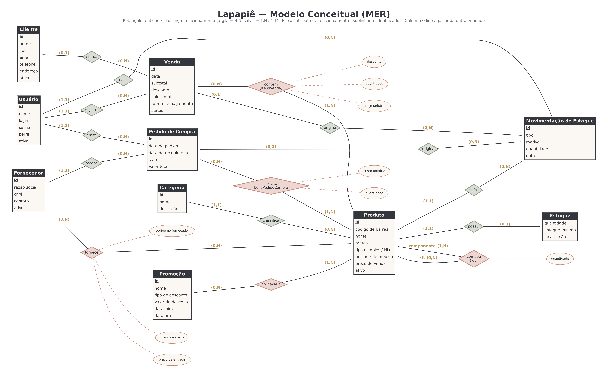

### Modelo físico

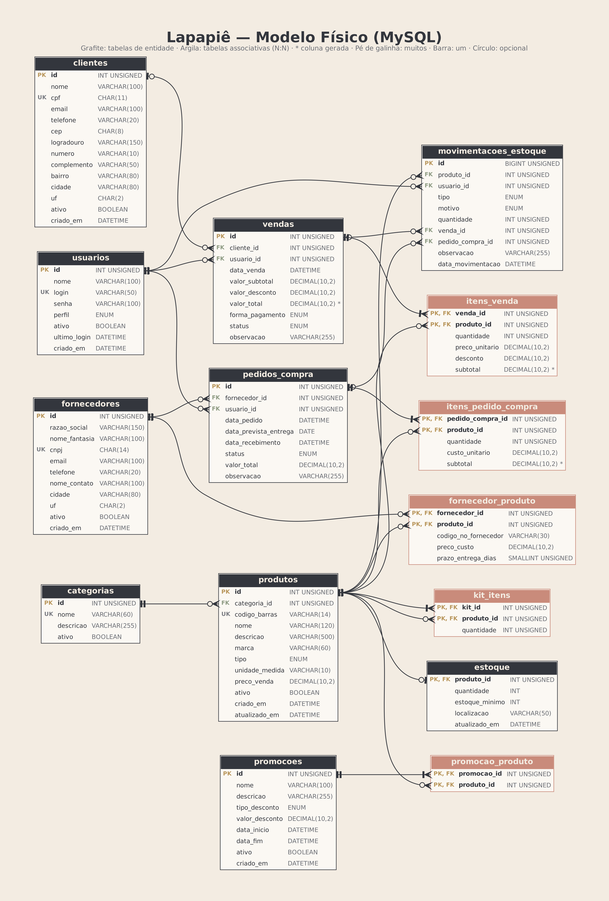

### Documentação da modelagem

As entidades, os relacionamentos, as cardinalidades e as justificativas de cada decisão de modelagem estão descritos em [detalhes_modelagem.md](docs/detalhes_modelagem.md).

---

## Passo a passo para instalação

### 1. Instale os pré-requisitos

| Programa | Versão | Observação |
|---|---|---|
| Windows | 10 ou 11 | O Windows Forms só roda no Windows |
| [Visual Studio](https://visualstudio.microsoft.com/pt-br/) | 2022 (17.8+) ou mais recente | Na instalação, marque a carga de trabalho **"Desenvolvimento para desktop com .NET"**. Ela já inclui o SDK do .NET 8 |
| [MySQL Server](https://dev.mysql.com/downloads/installer/) | 8.0.16 ou superior | Anote a senha definida para o usuário `root` durante a instalação |
| [MySQL Workbench](https://dev.mysql.com/downloads/workbench/) | Qualquer versão recente | Opcional, mas facilita a criação do banco |
| [Git](https://git-scm.com/downloads) | Qualquer versão recente | Para clonar o repositório |

> **Por que o MySQL precisa ser 8.0.16 ou superior?** É a partir dessa versão que o MySQL passa a validar as restrições `CHECK`. O banco usa essas restrições para recusar dados inválidos, como estoque negativo ou CPF fora do formato. Em versões anteriores, elas seriam ignoradas silenciosamente.

### 2. Clone o repositório

```bash
git clone https://github.com/beatrizklr/lapapie-system.git
cd lapapie-system
```

Outra opção é baixar o projeto em **Code → Download ZIP** no GitHub e extrair a pasta.

### 3. Abra a solução

Abra o arquivo **`Lapapie.sln`** no Visual Studio. Na primeira abertura, o Visual Studio restaura automaticamente os pacotes NuGet (MySql.Data, QuestPDF e ClosedXML). É preciso estar conectado à internet nesse momento.

Para confirmar que está tudo certo, use **Compilação → Compilar Solução** (`Ctrl + Shift + B`). A janela de saída deve mostrar a compilação sem erros.

---

## Passo a passo para criação do banco

O banco é criado por dois scripts que ficam na pasta `database/`. Eles devem ser executados **nesta ordem**:

| Ordem | Script | O que faz |
|---|---|---|
| 1º | `lapapie_create.sql` | Cria o banco `lapapie`, as 15 tabelas, as chaves, as restrições e as views |
| 2º | `lapapie_seed.sql` | Popula o banco com dados fictícios para demonstração |

> ⚠️ O `lapapie_create.sql` começa com `DROP DATABASE IF EXISTS lapapie`. Se já existir um banco com esse nome, **ele será apagado e recriado do zero**.

### Opção A — Pelo MySQL Workbench

1. Abra o MySQL Workbench e conecte-se ao servidor local, normalmente a conexão **Local instance MySQL80**, com o usuário `root`.
2. Vá em **File → Open SQL Script...** e abra o arquivo `database/lapapie_create.sql`.
3. Execute o script inteiro clicando no ícone de **raio** (⚡) ou pressionando `Ctrl + Shift + Enter`.
4. Repita os passos 2 e 3 com o arquivo `database/lapapie_seed.sql`.
5. Clique no ícone de atualizar no painel **Schemas**. O banco `lapapie` deve aparecer na lista.

### Opção B — Pelo terminal (PowerShell ou Prompt de Comando)

Na pasta raiz do repositório, execute:

```powershell
mysql -u root -p --default-character-set=utf8mb4 -e "source database/lapapie_create.sql"
mysql -u root -p --default-character-set=utf8mb4 -e "source database/lapapie_seed.sql"
```

A senha do `root` do MySQL será pedida em cada comando.

> **Por que não usar `mysql < arquivo.sql`?** O PowerShell não aceita o operador `<` para enviar um arquivo a um programa. O comando `source` é executado pelo próprio cliente do MySQL, então funciona igual no PowerShell e no Prompt de Comando. Já o parâmetro `--default-character-set=utf8mb4` garante que os acentos dos dados sejam gravados corretamente.
>
> Se aparecer o erro *"mysql não é reconhecido como um comando"*, a pasta do MySQL não está no `PATH` do Windows. Rode os comandos usando o caminho completo, por exemplo `& "C:\Program Files\MySQL\MySQL Server 8.0\bin\mysql.exe"`, ou use a Opção A.

### Conferindo a criação

Execute esta consulta no Workbench ou no terminal:

```sql
USE lapapie;
SELECT
    (SELECT COUNT(*) FROM produtos) AS produtos,
    (SELECT COUNT(*) FROM clientes) AS clientes,
    (SELECT COUNT(*) FROM vendas)   AS vendas;
```

O resultado esperado é **47 produtos** (44 simples e 3 kits), **25 clientes** e **129 vendas**.

### O que a massa de dados contém

Os dados simulam o funcionamento da loja entre agosto e novembro de 2026: 5 usuários, 25 clientes, 7 fornecedores, 47 produtos, 4 promoções, 11 pedidos de compra e 129 vendas. Também há casos preparados para a demonstração, como produtos com estoque baixo, vendas canceladas com devolução ao estoque, perdas registradas e pedidos em aberto. Todos os nomes, CPFs, CNPJs e e-mails são fictícios.

---

## Passo a passo para execução

### 1. Configure a conexão com o banco

Os dados de acesso ao MySQL ficam no arquivo `src/Lapapie/appsettings.json`:

```json
{
  "Conexao": {
    "Servidor": "localhost",
    "Porta": 3306,
    "Banco": "lapapie",
    "Usuario": "root",
    "Senha": ""
  }
}
```

Preencha o campo `"Senha"` com a senha do `root` do seu MySQL. Se o seu servidor usa outra porta ou outro usuário, ajuste também esses campos.

> Também é possível configurar a conexão **sem editar o arquivo**. Na tela de login, clique em **"Configurar conexão com o banco"**, preencha os dados, clique em **Testar** e depois em **Salvar**. O sistema grava as informações no `appsettings.json` que fica ao lado do executável.

### 2. Execute o sistema

- **Pelo Visual Studio:** com a solução aberta, pressione `F5` (ou clique em **▶ Lapapie**).
- **Pelo terminal**, na pasta raiz do repositório:

  ```powershell
  dotnet run --project src/Lapapie
  ```

### 3. Confira a conexão

Na tela de login, o rodapé indica o status do banco:

- **● Conectado ao MySQL em localhost:3306 (banco lapapie)**: tudo certo, pode entrar.
- **● Sem conexão com o banco**: revise o passo 1 e confirme que o serviço do MySQL está em execução.

### 4. Faça login

Todos os usuários da massa de dados usam a senha **`Lapapie@123`**:

| Usuário | Perfil | O que pode acessar |
|---|---|---|
| `admin` | Administrador | Todas as funcionalidades, incluindo relatórios, cancelamento de vendas e cadastro de usuários |
| `juliana.martins` | Vendedor | Vendas, histórico, clientes e consultas de produtos e estoque |
| `rafael.souza` | Vendedor | Vendas, histórico, clientes e consultas de produtos e estoque |
| `carlos.pereira` | Estoquista | Produtos, categorias, fornecedores, movimentações e pedidos de compra |
| `marcos.lima` | Vendedor (**inativo**) | Nenhum: o login é bloqueado, o que demonstra a exclusão lógica de usuários |

> **Sobre as senhas:** na massa de teste, as senhas estão gravadas em texto puro apenas para fins acadêmicos. No primeiro login de cada usuário, o sistema converte a senha automaticamente para um hash **PBKDF2**. Senhas de usuários novos já são gravadas protegidas.

### 5. Em caso de erro

Erros inesperados aparecem para o usuário como uma mensagem amigável. Os detalhes técnicos ficam registrados no arquivo `logs/erros.log`, criado na pasta do executável (`src/Lapapie/bin/Debug/net8.0-windows/` ao executar pelo Visual Studio).

---

## Screenshots do sistema

### Login e conexão com o banco

| Tela de login | Configuração da conexão |
|---|---|
| 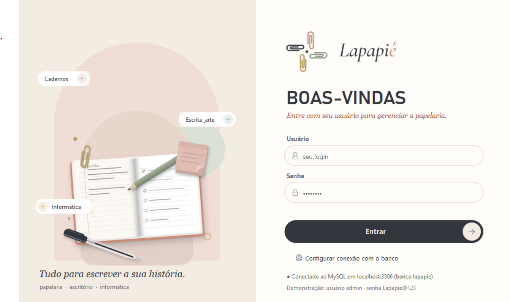 | 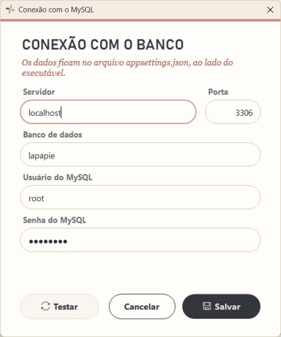 |

### Início (dashboard)

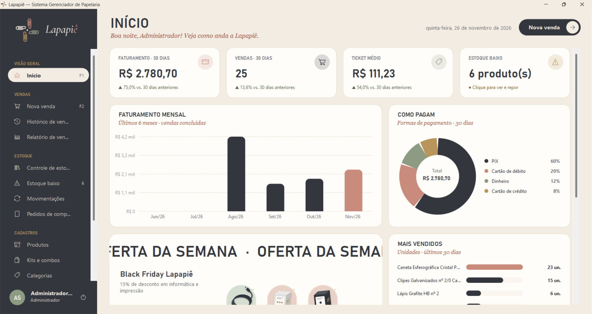

### Vendas

**Nova venda (caixa)**

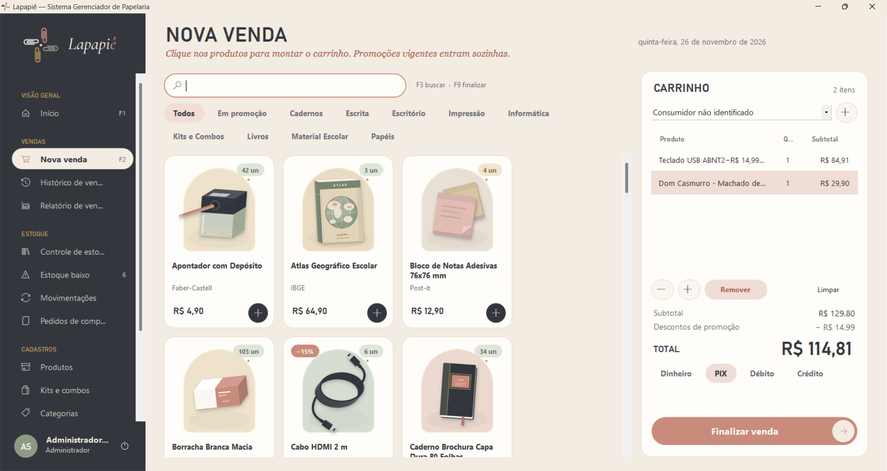

**Histórico de vendas**

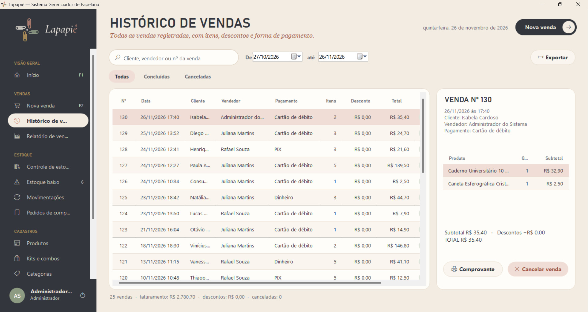

**Relatório de vendas**

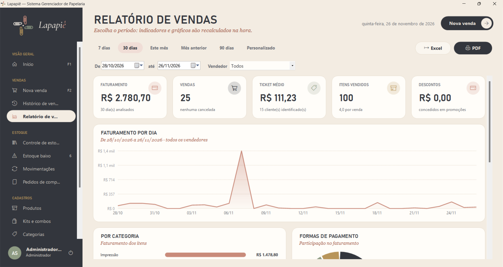

### Estoque

**Controle de estoque**

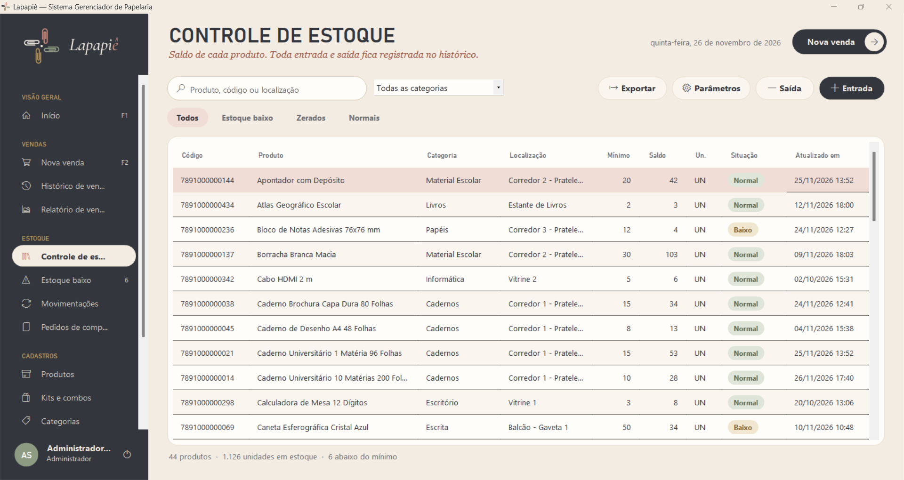

**Movimentar estoque**

<p align="center">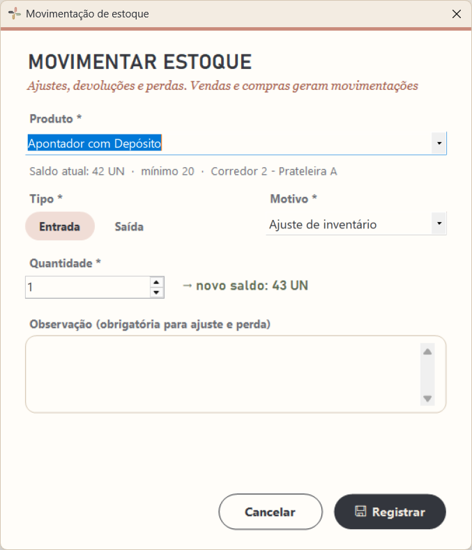</p>

**Estoque baixo**

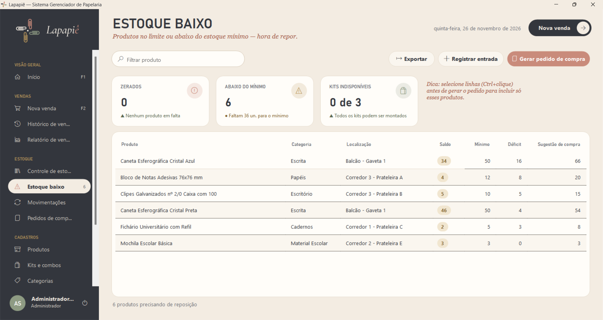

**Movimentações**

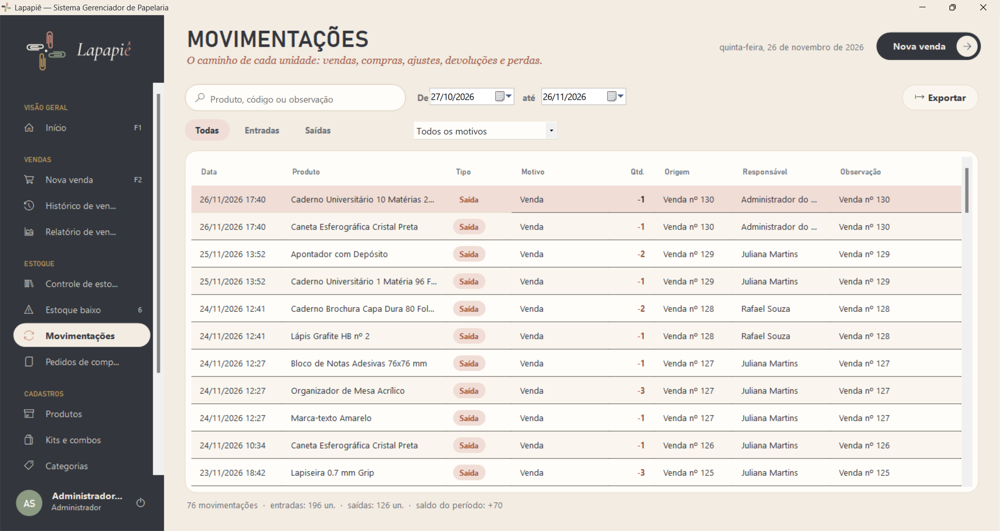

**Pedidos de compra**

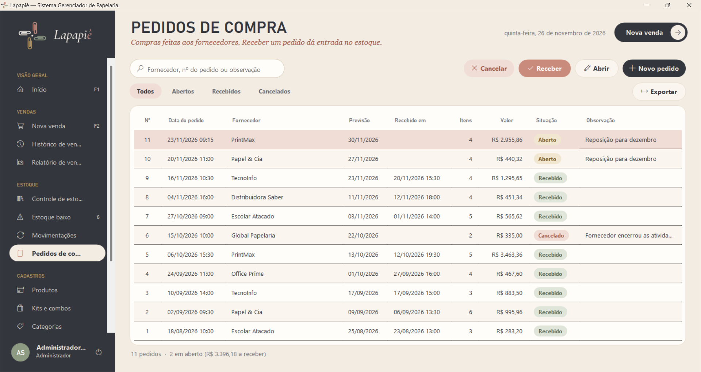

### Cadastros

**Produtos**

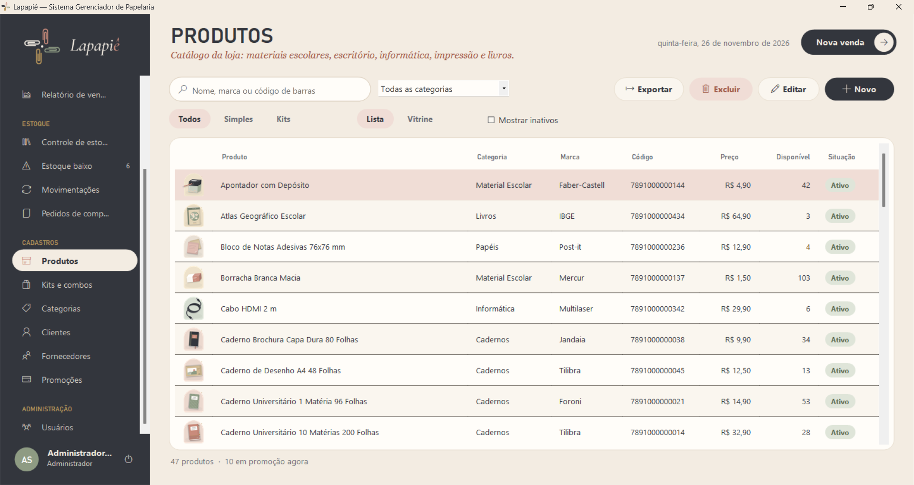

**Editar produto**

<p align="center">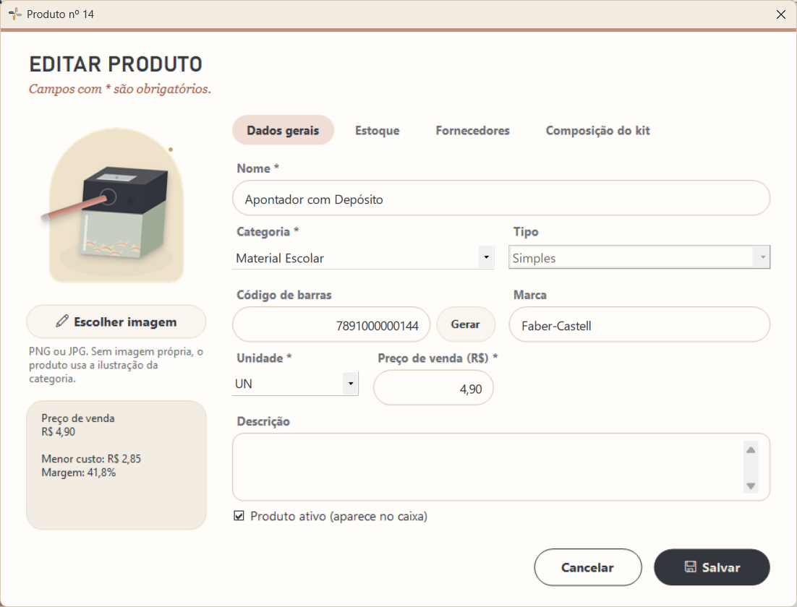</p>

**Kits e combos**

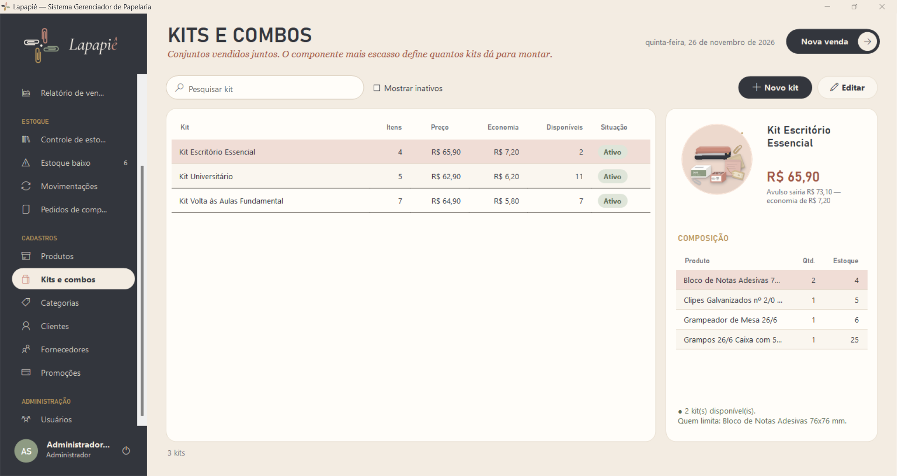

**Categorias**

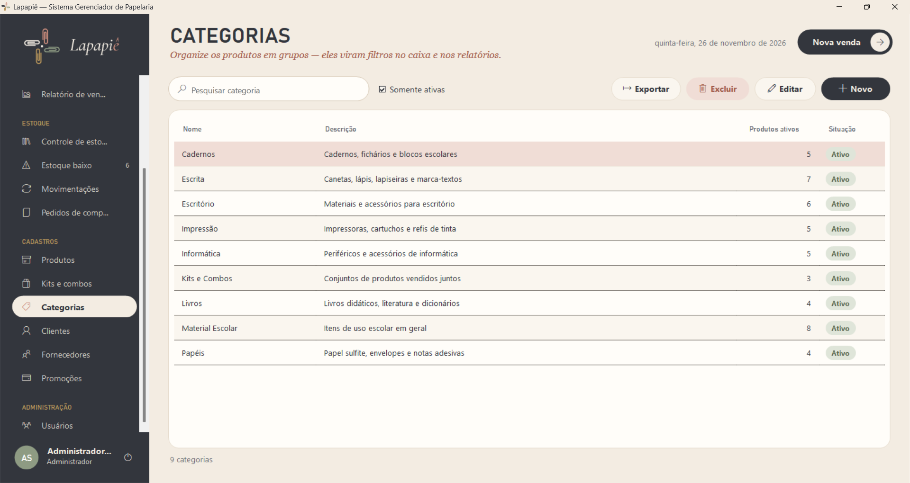

**Clientes**

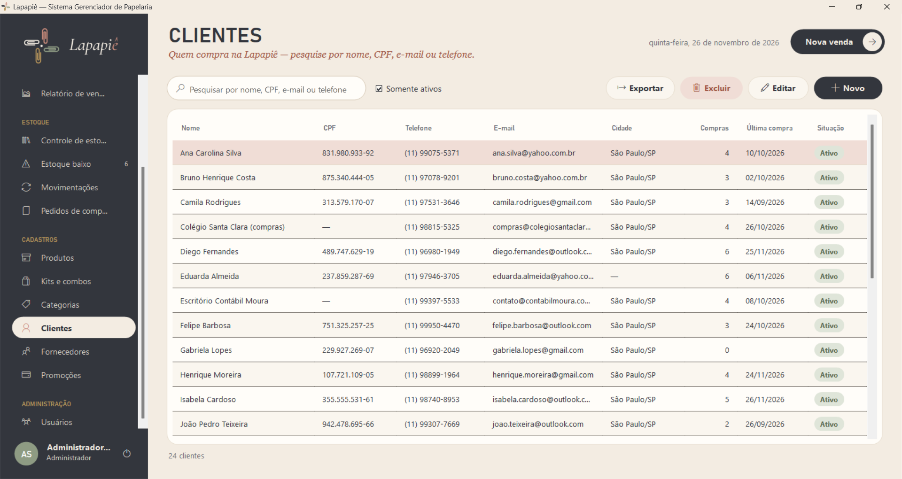

**Fornecedores**

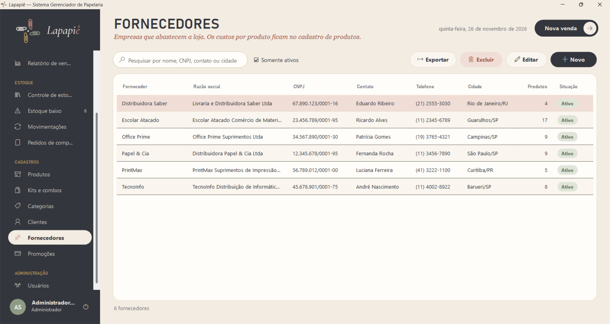

**Promoções**

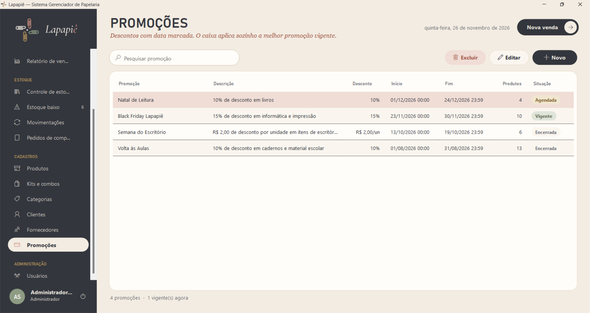

### Administração

**Usuários**

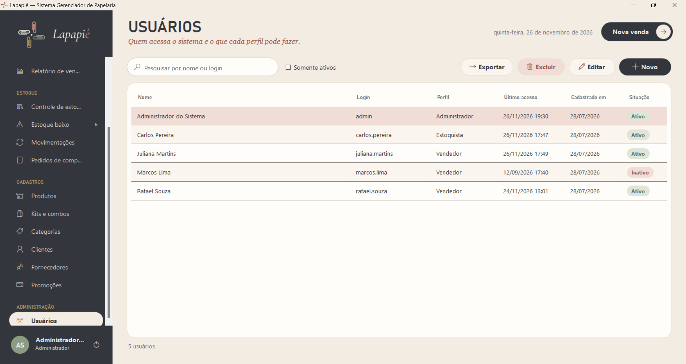