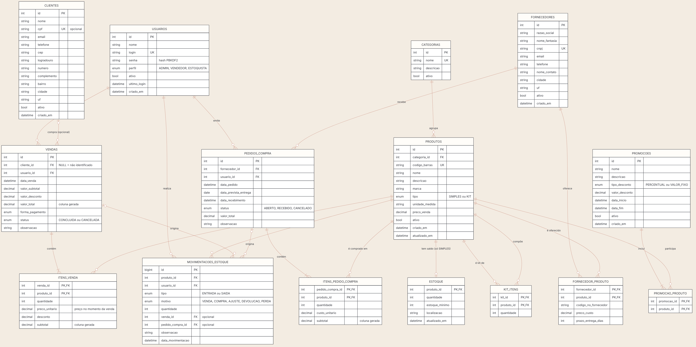
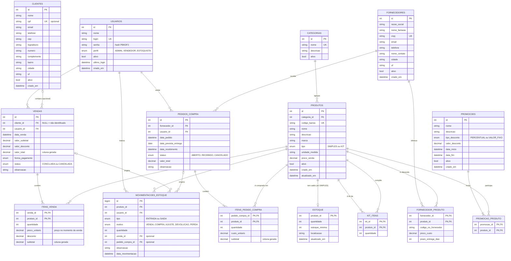

# Modelo Entidade-Relacionamento (MER) — Lapapiê

Este documento apresenta a **modelagem conceitual** do banco: as entidades, os atributos, os relacionamentos e as cardinalidades. A tradução para tabelas e tipos do MySQL está em [modelagem-fisica.md](modelagem-fisica.md). Os motivos de cada escolha estão em [decisoes-de-projeto.md](decisoes-de-projeto.md).

## Diagrama

Versão editável (texto) do mesmo diagrama:

> O GitHub desenha o diagrama abaixo automaticamente (sintaxe Mermaid). No Visual Studio Code, use uma extensão de pré-visualização Mermaid.
> Leitura das pontas: `||` = exatamente um · `o|` = zero ou um · `}o` = zero ou muitos · `}|` = um ou muitos.

## Entidades

| Entidade | O que representa | Identificador |
|---|---|---|
| **Usuário** | Pessoa que acessa o sistema, com um perfil de permissão | `id` (e `login` único) |
| **Cliente** | Quem compra; CPF e endereço são opcionais (balcão) | `id` (e `cpf` único quando informado) |
| **Categoria** | Grupo de produtos (Cadernos, Escrita, Informática...) | `id` (e `nome` único) |
| **Fornecedor** | Empresa que vende para a papelaria | `id` (e `cnpj` único) |
| **Produto** | Item à venda. Pode ser **SIMPLES** ou **KIT** (combo de outros produtos) | `id` (e `codigo_barras` único) |
| **Estoque** | Saldo atual, estoque mínimo e localização de um produto simples | `produto_id` |
| **Promoção** | Desconto com período de validade | `id` |
| **Venda** | Cabeçalho da venda: cliente, vendedor, totais e pagamento | `id` |
| **Pedido de compra** | Compra feita a um fornecedor | `id` |
| **Movimentação de estoque** | Registro histórico de cada entrada/saída | `id` |

**Entidades associativas** (nascem dos relacionamentos N:N e têm atributos próprios): **Item de venda**, **Item de pedido de compra**, **Fornecedor × Produto**, **Promoção × Produto** e **Item de kit**.

## Relacionamentos e cardinalidades

| Relacionamento | Cardinalidade | Leitura |
|---|---|---|
| Categoria — Produto | 1 : N | Uma categoria agrupa vários produtos; cada produto tem exatamente uma categoria. |
| Produto — Estoque | 1 : 0..1 | Todo produto **simples** tem uma linha de estoque; kits não têm (a disponibilidade deles é calculada). |
| **Venda — Produto** | **N : N** | Uma venda tem vários produtos e um produto aparece em várias vendas → `itens_venda` (quantidade, preço do momento, desconto). |
| **Fornecedor — Produto** | **N : N** | Um fornecedor vende vários produtos e um produto pode ter vários fornecedores → `fornecedor_produto` (custo, prazo, código). |
| **Promoção — Produto** | **N : N** | Uma promoção vale para vários produtos e um produto pode estar em várias promoções → `promocao_produto`. |
| **Pedido de compra — Produto** | **N : N** | Um pedido tem vários produtos e um produto aparece em vários pedidos → `itens_pedido_compra` (quantidade, custo). |
| **Kit — Produto** (autorrelacionamento) | **N : N** | Um kit é composto por vários produtos e um produto pode estar em vários kits → `kit_itens` (quantidade). |
| Cliente — Venda | 0..1 : N | Um cliente faz várias vendas; a venda pode não ter cliente (consumidor não identificado). |
| Usuário — Venda / Pedido / Movimentação | 1 : N | Toda operação registra quem a fez (auditoria). |
| Fornecedor — Pedido de compra | 1 : N | Cada pedido é feito a um único fornecedor. |
| Produto — Movimentação | 1 : N | Cada produto acumula seu histórico de entradas e saídas. |
| Venda / Pedido — Movimentação | 0..1 : N | A movimentação aponta a origem quando vem de uma venda ou de uma compra; ajustes manuais não têm origem. |

São **5 relacionamentos muitos-para-muitos** (o enunciado pede no mínimo 3).

## Regras de negócio representadas no modelo

- **Estoque nunca negativo** (`CHECK quantidade >= 0`) e baixa feita **em transação** junto com a venda.
- **Kit não contém a si mesmo** (`CHECK kit_id <> produto_id`).
- **Promoção coerente**: fim depois do início; percentual até 100%.
- **Movimentação coerente com o motivo**: VENDA é sempre saída e tem `venda_id`; COMPRA é sempre entrada e tem `pedido_compra_id`; PERDA é sempre saída.
- **Pedido recebido tem data de recebimento** (`CHECK status <> 'RECEBIDO' OR data_recebimento IS NOT NULL`).
- **Totais calculados pelo banco** (`valor_total`, `subtotal` são colunas geradas) — não há como gravar um total que não bate com os itens.
